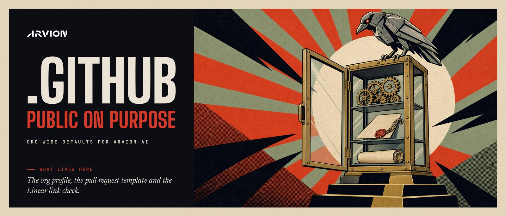

<p align="center">
  
</p>

<p align="center">
  <a href="#why-this-repository-is-public">Why it is public</a>
  ·
  <a href="#what-is-in-it-and-what-is-not">What is in it</a>
  ·
  <a href="#before-you-add-something">Before you add something</a>
  ·
  <a href="#linear-link-check">Linear link check</a>
</p>

# arvion-ai/.github

Org-wide defaults for arvion-ai. GitHub reads these files from this repository and applies them across the organization.

| Path | What it is | Used by |
| --- | --- | --- |
| [`profile/README.md`](profile/README.md) | The public profile at [github.com/arvion-ai](https://github.com/arvion-ai) | Anyone who visits the organization |
| [`.github/PULL_REQUEST_TEMPLATE.md`](.github/PULL_REQUEST_TEMPLATE.md) | The default pull request template | Every repository without its own template |
| [`.github/workflows/linear-link-check.yml`](.github/workflows/linear-link-check.yml) | The reusable Linear link check | Repositories that opt in, and the org ruleset |
| [`workflow-templates/`](workflow-templates/) | The "Linear link check" starter workflow | **Actions → New workflow** in any repository |
| [`actions/linear-link-check/`](actions/linear-link-check/) | The TypeScript action behind the check | The reusable workflow |

## Why this repository is public

Each of these needs it:

1. **The org profile.** GitHub shows `profile/README.md` on the organization page only when it is in a public `.github` repository. A private profile is possible, from a separate `.github-private` repository, but only members see it. ([GitHub docs](https://docs.github.com/en/organizations/collaborating-with-groups-in-organizations/customizing-your-organizations-profile))
2. **The pull request template.** It is one of GitHub's default community health files, and GitHub reads those only from a public `.github` repository: "A repository for default files cannot be private." ([GitHub docs](https://docs.github.com/en/communities/setting-up-your-project-for-healthy-contributions/creating-a-default-community-health-file))
3. **The Linear link check.** The reusable workflow fetches the action from this repository with `actions/checkout`, using the calling repository's own `GITHUB_TOKEN`. That token can read only the repository it runs in ([GitHub docs](https://docs.github.com/en/actions/concepts/security/github_token)), so the fetch works because this repository is public. If it were private, every repository would need a cross-repository token stored as a secret, or the check would have to be rebuilt around GitHub's private sharing setting. Public repositories could not call a private reusable workflow at all, and starter workflows from a private `.github` are offered only to private repositories. ([GitHub docs](https://docs.github.com/en/actions/reference/workflows-and-actions/reusing-workflow-configurations))

None of it needs to be private. It is configuration and a small open check.

## What is in it, and what is not

Last checked on 2026-10-30, across every file, every commit on every branch and every pull request.

**In it**

- The org profile text and its images.
- The pull request template.
- The Linear link check: its source, tests, bundled build, and an npm lockfile that resolves only from the public npm registry.
- Our Linear team keys (`ARV`, `OSS`, `KIN`) as the check's defaults. A key opens nothing without a login to our Linear workspace.

**Not in it**

- No secrets. The repository has no Actions secrets, variables, environments, deploy keys or webhooks, and no credential appears in any file or commit.
- No Linear API key. The check never calls Linear. It reads the pull request from the event GitHub sends, and calls the GitHub API, read-only, only to tell whether a failing pull request changes any files.
- No customer names or data, no product source, and no infrastructure details such as servers, cloud accounts or IP addresses.
- No logs from other repositories. When a repository runs the check, the run and its logs stay in that repository.

**How the workflows here stay safe in public**

- They run on `pull_request`, never `pull_request_target`, so a pull request from a fork gets a read-only token and no secrets.
- Each workflow asks only for read access: `contents: read`, plus `pull-requests: read` for the check. The repository's default token is read-only too.
- The checkout of the action sets `persist-credentials: false`, so no token is left on disk for later steps.
- Workflow runs from a first-time outside contributor wait for a maintainer's approval.

## Before you add something

Everything here is public as soon as it is pushed: files, commit messages, pull requests and their comments. GitHub keeps edit history, so removing a line later does not unpublish it.

- No secrets, tokens or keys, expired ones included. A workflow that needs one gets it from the calling repository's secrets.
- No customer names, customer repository names, or anything copied from a customer's code.
- No details of private repositories, internal systems or audit scope in pull request titles, descriptions or comments. Link the Linear issue and keep that discussion there.
- Keep workflows on `pull_request` with read-only permissions.
- Commit with your GitHub no-reply address if you don't want your personal email on a public commit: **Settings → Emails → Keep my email addresses private**.

## Linear link check

Every pull request into a production branch must be linked to a Linear issue, so it shows up on that issue through the Linear GitHub integration. The `linear-link` check fails a PR that Linear itself would not link.

### What the check does

A PR passes if any one of these is true. The rules mirror how Linear links PRs.

1. **The PR description contains a magic word followed by an issue key**, e.g. `Part of ARV-123`. This is the recommended form, and the PR template starts with it.
   - Use a non-closing word such as `Part of` when the PR is one part of the work. A closing word such as `Fixes` closes the issue when the PR merges.
   - Closing words: close, closes, closed, closing, fix, fixes, fixed, fixing, resolve, resolves, resolved, resolving, complete, completes, completed, completing, implement, implements, implemented, implementing, linear issue.
   - Non-closing words: ref, refs, references, part of, related to, relates to, contributes to, toward, towards.
   - Magic words and keys match in any case. The key may be bold or italic, given as a Linear issue URL, or be one of a list: `Fixes ENG-1, ARV-2` and `Fixes DES-5 and ARV-2` both link `ARV-2`.
   - A bare key without a magic word does **not** count, because Linear ignores it. Neither does a key in backticks or a Markdown link, or anything inside an HTML comment.
2. **The branch name contains an issue key**, in any case. Linear's generated branch names, such as `michal/arv-123-some-title`, already do. In Linear, press <kbd>Cmd/Ctrl</kbd>+<kbd>Shift</kbd>+<kbd>.</kbd> on an issue to copy its branch name.
3. **The PR title contains an issue key**, in any case, e.g. `ARV-123: Add billing export`.

`skip ARV-123` or `ignore ARV-123` in the description makes Linear fully unlink the PR from that issue, even if the key is in the branch name or title. The check follows suit and does not count that key anywhere.

The Atlassian app is installed on our repos and Jira issue numbers overlap Linear's, so a key in a branch name or title can also link an unrelated Jira ticket. Prefer the description.

Keys must not touch a letter or digit: `XARV-123` and `ARV-123x` do not count as `ARV-123`, but `feature_ARV-123` does. Only the team keys in `team-keys` are accepted. With `team-keys: "*"`, any key counts, but outside the branch name only uppercase ones, so words like `utf-8` are not taken for keys. The check tests only the shape of the key, not whether the issue exists, since it has no Linear API access.

These PRs pass with a notice instead of being checked:

- PRs opened by a bot, i.e. any author whose login ends in `[bot]` (Dependabot, Renovate, GitHub Actions, and so on), but only where `exempt-bots` is `true`. By default a bot PR needs a key like any other.
- PRs with the `skip-label` label, if one is set. None is set by default: a label can be added by anyone with triage access, with no reason and no record. A PR that has no ticket yet gets one.
- PRs whose base branch is not in `target-branches`. By default the check runs on PRs into `main` and `production`, so release PRs need a Linear key too.
- PRs that change no files, i.e. whose head commit has the same tree as the merge base. After each release, GitHub offers to open such a PR from `production` into `main`: it carries only the release merge commits, and a squash merge would add an empty commit. Close it. The check tells from the git trees, not from the payload's `changed_files`, which GitHub can report as 0 for a PR that does change files.

When a PR fails, the job summary explains the three ways to link it. The check reads the PR from the event payload. Only for a PR that would fail does it call the GitHub API, read-only with the workflow's token, to tell whether the PR changes any files; if that call fails, the PR fails. It never comments on the PR. It re-runs when the PR is edited, labeled, unlabeled, or pushed to, so fixing the title, description, or label is enough.

An empty input uses the default. The defaults are defined once, in [`src/match.ts`](actions/linear-link-check/src/match.ts), except `github-token`'s, which is in `action.yml`.

| Input             | Default              | Meaning                                                                                    |
| ----------------- | -------------------- | ------------------------------------------------------------------------------------------ |
| `team-keys`       | `ARV,OSS,KIN`        | Comma-separated Linear team keys. `*` accepts any key matching `[A-Z][A-Z0-9]+-<number>`.  |
| `target-branches` | `main,production`    | Comma-separated base branches to enforce on. `*` enforces on all branches.                 |
| `skip-label`      | none                 | Label that exempts a PR. Empty disables the exemption.                                     |
| `exempt-bots`     | `false`              | When `true`, a PR opened by a bot passes without a key.                                    |
| `enforce`         | `true`               | When `false`, an unlinked PR gets a warning and the check still passes.                    |
| `github-token`    | the workflow's token | Reads a failing PR's commits to tell whether it changes any files. Needs `contents: read`. |

The pieces:

- [`actions/linear-link-check/`](actions/linear-link-check/) is the TypeScript action. The matching rules live in `src/match.ts`.
- [`.github/workflows/linear-link-check.yml`](.github/workflows/linear-link-check.yml) is the reusable workflow. Its job is named `linear-link`.
- [`workflow-templates/linear-link-check.yml`](workflow-templates/linear-link-check.yml) is the starter workflow that repos add.
- [`.github/PULL_REQUEST_TEMPLATE.md`](.github/PULL_REQUEST_TEMPLATE.md) is the org-wide default PR template, which starts with a `Part of ARV-___` line.

### Opting a repo in

1. In the repo, go to **Actions → New workflow** and pick **Linear link check** under "By arvion-ai".
2. Commit the file it creates at `.github/workflows/linear-link-check.yml`. To change a setting, uncomment the `with:` block, for example to set `enforce: false`.

The starter workflow also runs on `merge_group`, so the required check reports in repos that use a merge queue. Merge-queue runs pass with a notice, since the PR was already checked.

A repo that opts in this way should report the check as **`linear-link / linear-link`**: GitHub prefixes the reusable workflow's job name with the calling job's name. Confirm the name on a real PR before making it required.

### Making it required for all repos

Create an org ruleset under **Organization settings → Repository → Rulesets → New branch ruleset**:

1. Set **Enforcement status** to *Active*. Start with *Evaluate* if you want to watch it first; GitHub's docs list that mode as GitHub Enterprise only, so check that it is offered on our plan.
2. Under **Target repositories**, choose *All repositories*.
3. Under **Target branches**, add *Include default branch* and `production`, matching `target-branches`.
4. Enable **Require status checks to pass** and add the check `linear-link / linear-link`, the name a repo produces with the starter workflow. Leave the source as "any source", or pick GitHub Actions.
5. Under **Bypass list**, add whoever may merge without a ticket in an emergency, e.g. org admins. This replaces a skip label: only they can bypass, and GitHub records each bypass.

A required status check only works in repos that run the workflow. In a repo without it, the check never reports and PRs into `main` are blocked. Roll the starter workflow out to every repo before turning on this rule, or limit the ruleset's target repositories to those that have it.

### Alternative: "Require workflows to pass"

If our plan offers the ruleset rule **Require workflows to pass before merging** (GitHub Enterprise Cloud), use it instead of the status-check rule. Repos then don't need their own workflow file:

1. In the same ruleset, enable **Require workflows to pass before merging**.
2. Add the workflow: repository `arvion-ai/.github`, path `.github/workflows/linear-link-check.yml`, ref `main`.

GitHub then runs the workflow in every targeted repo through its `pull_request` trigger with the default inputs. The check appears as `linear-link`. To change the inputs for this path, change the defaults in `actions/linear-link-check/src/match.ts` and rebuild `dist/`. Repos that also added the starter workflow would run the check twice, so pick one approach.

### Recommended rollout

1. Add the starter workflow to repos with `enforce: false` in its `with:` block. For the "Require workflows" path, temporarily make an empty `enforce` mean false in `src/index.ts` instead.
2. For about a week, unlinked PRs get a warning annotation and a job summary, but nothing is blocked. Check who is getting warnings, whether any repos need extra team keys or target branches, and whether our compliance tooling counts release PRs correctly.
3. Switch to `enforce: true` and turn on the ruleset.

### Developing the action

```sh
cd actions/linear-link-check
npm ci
npm test        # vitest
npm run lint    # eslint + tsc --noEmit
npm run build   # bundles src/ into dist/index.js
```

`dist/index.js` is committed because the runner executes it directly. Commit it together with every source change. CI fails if it is out of date.
